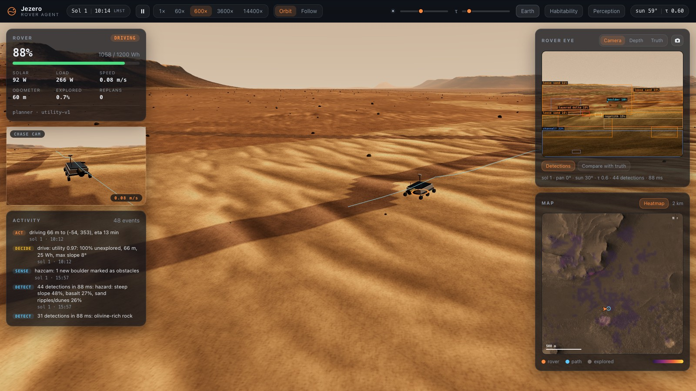
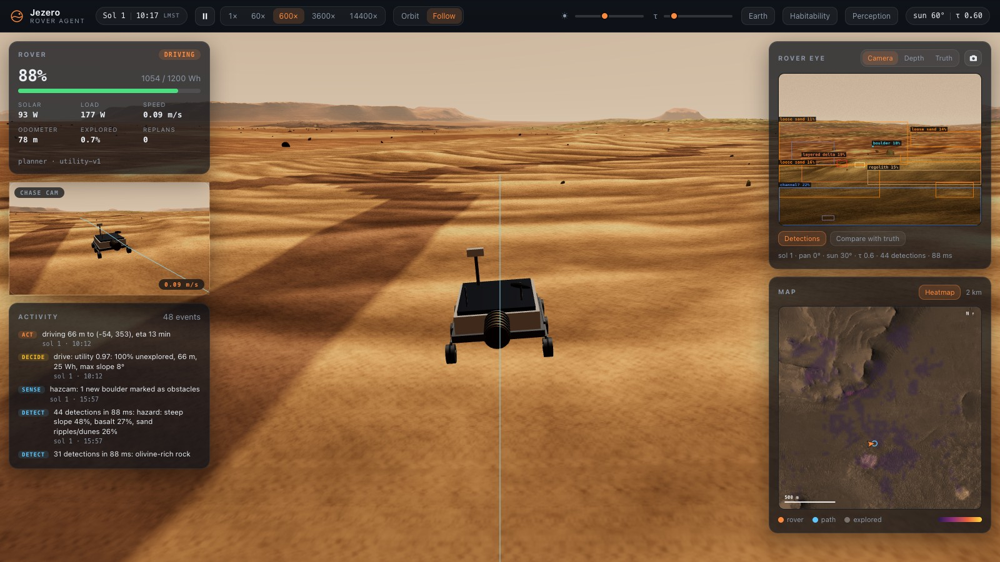
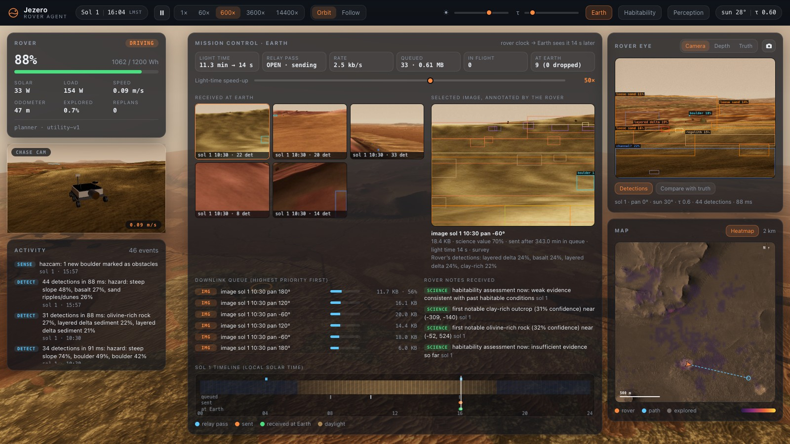
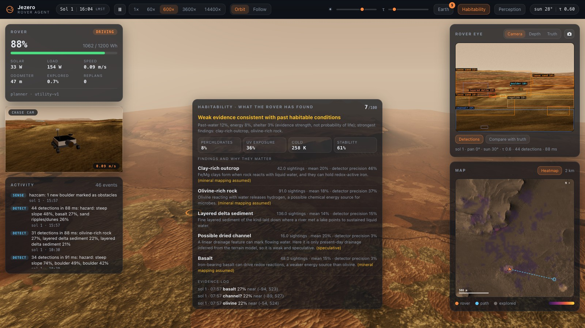
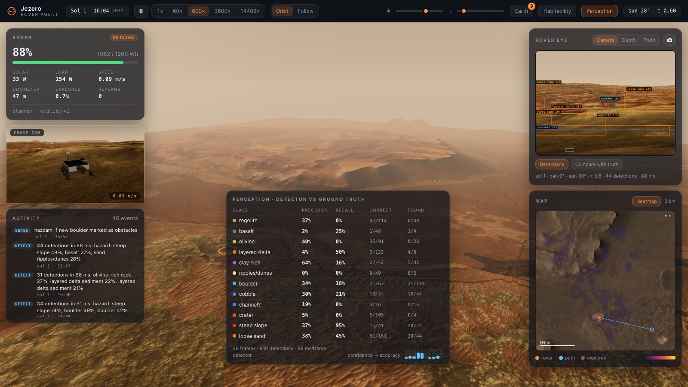
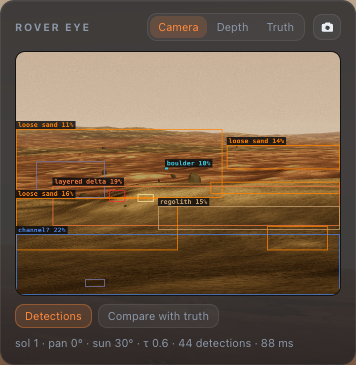
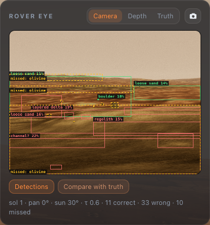
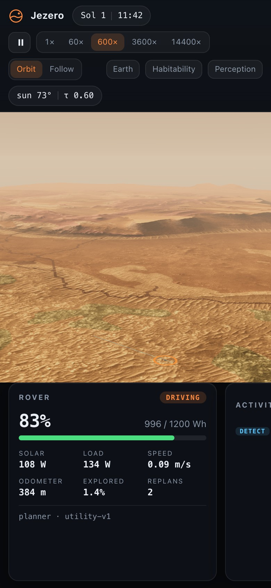
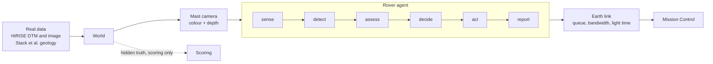

<div align="center">

# Jezero Rover Agent

**An autonomous rover explores a real patch of Mars, sees through a simulated camera, and downlinks what it finds to Earth.**

[](https://github.com/aluinn/mars-agent/actions/workflows/ci.yml)
[](https://github.com/aluinn/mars-agent/actions/workflows/codeql.yml)
[](LICENSE)
[](https://github.com/aluinn/mars-agent/stargazers)
<a href="https://vercel.com/new/clone?repository-url=https%3A%2F%2Fgithub.com%2Faluinn%2Fmars-agent"></a>

<!--
  HERO PLACEHOLDER: replace the screenshot below with a short screen recording or GIF of the rover driving
  (for example docs/assets/<your-recording>.gif or an uploaded GitHub video) when you have one.
-->

**[▶ Try it live: mars-agent-blond.vercel.app](https://mars-agent-blond.vercel.app)**



[Live demo](https://mars-agent-blond.vercel.app) · [Deploy](#deploy) · [Architecture](docs/ARCHITECTURE.md) · [Roadmap](ROADMAP.md) · [Contributing](CONTRIBUTING.md)

</div>

A rover agent drives across a 2 x 2 km window of Jezero Crater built from **real orbital data**: the 1 m HiRISE elevation model and the 25 cm HiRISE orthoimage, with the Stack et al. (2020) geologic map on top. It decides where to go, sees the world only through a simulated mast camera, assesses what it finds for evidence consistent with past habitable conditions, and sends its best findings to Earth over a slow, bandwidth-limited link with a real light-time delay. It runs entirely in your browser.

It is honest about itself. Elevation, imagery and geology polygons are real; rocks, mineral labels, the power system and the data link are approximations, and the detector's accuracy is measured and published, including where it is poor. See [the FAQ](#faq).

## Features

- **Real terrain at true scale.** A 2 km window of the 1 m HiRISE DTM resampled to a 1024 x 1024 height map (1.95 m per pixel, 114 m of relief), textured with the real 25 cm orthoimage (4096 x 4096): delta front, crater-floor edge, megaripples and craters.
- **Real geology.** The Stack et al. (2020) photogeologic map rasterised onto the grid, plus slope hazards, craters and possible channels derived from the elevation model.
- **Mars lighting and weather.** Sun elevation from local time, latitude and season; dust opacity (tau) dims and tints the scene; a butterscotch sky with a blue sunset halo; cast shadows. Gravity 3.71 m/s2 and a 24 h 39 m 35 s sol.
- **Slope-aware navigation.** A* on the height map that refuses slopes over 20 degrees, avoids boulders the rover has seen, and replans when it meets a new one. Speed is capped at 0.1 m/s.
- **Energy model.** A solar array, battery and night hibernation; drive cost uses the rover's mass and Mars gravity; the planner leaves enough charge to survive the night and stops before sunset.
- **A pluggable decision layer.** `Planner.decide()` can return a decision or a promise, so an LLM planner behind a serverless function can be added later. Today's planner is a rule and utility planner whose goals weigh unexplored area, terrain relief and detected habitability evidence.
- **Perception through a camera, not a cheat.** A Mastcam-Z-like camera (25.4 x 19.2 degrees, 640 x 480, 1500 m range) renders colour, metric depth and a hidden ground-truth pass. The agent only ever sees the image and depth.
- **A scored detector.** 12 classes (terrain types from a trained classifier, boulders and cobbles from depth) with confidence that falls with range, low sun, dust and occlusion and never reaches 100%. A compare view shows correct, wrong and missed detections; per-class precision and recall are computed against the hidden truth.
- **Habitability assessment.** Past-water, energy and shelter evidence, discounted by measured detector precision and limited by perchlorates, UV, cold and instability. The verdict says "evidence consistent with past habitable conditions" and never claims life. Evidence log and a map heatmap included.
- **An Earth link.** Two relay passes a sol, a priority queue ranked by science value, a one-way light time of 11.3 minutes at the start with a speed-up slider, rover notes, and a Mission Control screen with the annotated images Earth has received.
- **A mission-control UI.** Orbit and follow cameras, a chase-camera second screen, a minimap on the real orthoimage, time controls up to 14,400x, keyboard shortcuts, and a layout that works on a phone.
- **Tested.** 81 unit tests, an end-to-end smoke test, ESLint, CI and CodeQL.

## Screenshots

| | |
| --- | --- |
| <br><sub>**Follow camera.** The rover on its path across megaripples, long morning shadows, chase cam and live status.</sub> | <br><sub>**Mission Control.** Images that reached Earth, the downlink queue ranked by science value, rover notes and the sol timeline.</sub> |
| <br><sub>**Habitability verdict.** Evidence, why it matters, what counts against it, and a caveat on every claim.</sub> | <br><sub>**Perception scorecard.** Precision and recall per class against the hidden ground truth.</sub> |

<details>
<summary>More screenshots</summary>

| | | |
| --- | --- | --- |
| <br><sub>Rover eye: detections with confidence.</sub> | <br><sub>Compare mode: green correct, red wrong, dashed yellow missed.</sub> | <br><sub>On a phone.</sub> |

</details>

## How it works



1. **The world is real data plus honest labels.** Heights and imagery come from USGS HiRISE products; geology polygons from Stack et al. (2020). Where the data cannot say something (rocks, minerals), the world is synthetic and says so.
2. **The agent only knows what its camera shows.** A hidden second render gives every pixel its true object, used to score the detector and never given to the agent. Navigation uses the orbital height map plus boulders the rover has actually seen.
3. **Evidence becomes a careful assessment.** Detections feed a per-location habitability score, discounted by how reliable the detector has been for each class, and limited by perchlorates, UV, cold and unstable ground.
4. **Findings travel the way they would on a real mission.** Images queue by science value, go out in short relay passes at a small data rate, and reach Earth one light-time later. Mission Control shows what arrived.

Details, sequence diagram, failure modes and design decisions: [docs/ARCHITECTURE.md](docs/ARCHITECTURE.md).

## Quick start

You need **Node.js 22.12 or newer** and a browser with WebGL 2. The repo contains all the data the app needs; no downloads or Python are required.

```bash
git clone https://github.com/aluinn/mars-agent.git
cd mars-agent
npm ci
npm run dev        # open http://localhost:5173
```

The rover starts driving on its own. Press `Space` to pause, `1`-`5` to change speed, `F` to follow it, `C` to take an image, and `P`, `H`, `E` to open the Perception, Habitability and Earth panels.

| Command | What it does |
| --- | --- |
| `npm run dev` | Dev server with hot reload |
| `npm run build` | Typecheck, then build to `dist/` |
| `npm run preview` | Serve the production build |
| `npm run typecheck` | `tsc --noEmit` |
| `npm run lint` | ESLint |
| `npm test` | 81 unit tests (about a second) |
| `npm run test:e2e` | Playwright smoke test against the production build |
| `npm run bench` | Frame, capture, detector and path-finding timings ([how](docs/PERFORMANCE.md)) |
| `npm run train` | Retrain the terrain classifier and re-score it ([how](docs/PERCEPTION.md)) |

## Deploy

It is a static site, so any static host works. On Vercel:

1. Click **Deploy with Vercel** at the top of this page (or import the repo at <https://vercel.com/new>).
2. Vercel detects Vite. The defaults are correct: build command `npm run build`, output directory `dist`, no environment variables.
3. The live demo for this repo is at <https://mars-agent-blond.vercel.app>.

The `public/data/` folder (4.4 MB) is served with the site.

## FAQ

**What is real data and what is approximated?**

| Real | Approximated or synthetic |
| --- | --- |
| Elevation (1 m HiRISE DTM, resampled to 1.95 m) | **Mineral labels.** The geologic map has units, not minerals; the unit-to-mineral association is assumed |
| Image brightness (25 cm HiRISE orthoimage) | **Rocks.** Positions and sizes are synthetic |
| Geology polygons (Stack et al. 2020) | **Colours.** The orthoimage is greyscale; class tints are synthetic |
| Slope hazards, craters, drainage from the DEM | **Power, data rate, radio, surface temperature** are assumptions; the rover is a hypothetical solar vehicle |
| Gravity, sol length, solar geometry | **Light time** uses circular orbits (4.4 to 21 min, real range about 3 to 22) |
| Camera field of view and pixel scale (Mastcam-Z) | **Habitability weights** are my choices, not measurements |

Sources, licences and limits are in [docs/DATA_SOURCES.md](docs/DATA_SOURCES.md).

**Does it detect life?** No. It assesses *evidence consistent with past habitable conditions* from what the detector reports, and says how weak that evidence is. It never claims life.

**How good is the detector?** Modest, and the repo says so. On 60 held-out frames, overall terrain tile accuracy is about 33%. Steep slopes (91% recall) and loose sand are the best classes; basalt, olivine, clay-rich rock and delta sediment are near chance, because RGB imagery and the subtle synthetic class tints cannot separate minerals (real rovers use multispectral data). Confidence is only roughly calibrated. Full tables and the evaluation protocol: [docs/PERCEPTION.md](docs/PERCEPTION.md).

**Does it run on my laptop?** On an Apple M1 Pro GPU the median frame is 16.7 ms (60 fps), and with image capture suppressed the 99th percentile is also 16.8 ms. With normal image capture it hitches, because the detector runs on the main thread for about 85 ms each time the rover takes a picture (99th percentile 150 to 167 ms). On a software renderer (no GPU) frames take about 3 seconds, so you need a GPU. Numbers, machine and how to reproduce: [docs/PERFORMANCE.md](docs/PERFORMANCE.md).

**Is the data free to use?** The code is MIT. The USGS data licences were not verifiable automatically (the pages do not expose usage terms to scripts), so I have not assumed anything: check the terms before redistributing the raw products. The repo ships only small derived crops.

**Why is carbonate-bearing rock never detected?** It is defined, but no carbonate unit falls inside this 2 km patch, so there is nothing to find. A second landing site would fix that ([ROADMAP.md](ROADMAP.md)).

**Is there an LLM planner?** Not yet. The planner interface is built for one (asynchronous decisions are already supported) and it is on the [roadmap](ROADMAP.md). Keys would stay in a serverless function, never in the browser.

**Why is TypeScript pinned to 6.0?** `typescript-eslint` does not yet support 6.1 or the native TypeScript 7. See [CONTRIBUTING.md](CONTRIBUTING.md).

## Good first issues

Small, scoped tasks grounded in the real code. The drafts are in [docs/issues/](docs/issues/).

| Issue | Where to start |
| --- | --- |
| [Add unit tests for scoring edge cases](docs/issues/01-scoring-edge-case-tests.md) | `src/perception/scoring.ts` |
| [Add a keyboard-shortcut help overlay](docs/issues/02-shortcut-help-overlay.md) | `src/main.ts`, `index.html` |
| [Show images received per sol in Mission Control](docs/issues/03-earth-history-strip.md) | `src/ui/earthPanel.ts` |
| [Export the habitability evidence log as JSON](docs/issues/04-export-evidence-log.md) | `src/habitability/model.ts` |
| [Mark classes absent from the patch in the Perception panel](docs/issues/05-class-not-in-patch-hint.md) | `src/ui/perceptionPanel.ts` |

Larger enhancements (LLM planner, second landing site, a Web Worker detector, real mineral maps, a better classifier) are drafted too.

## Roadmap

See [ROADMAP.md](ROADMAP.md).

## Credits

**Data**

- Terrain: Mars 2020 Terrain Relative Navigation HiRISE DTM mosaic and orthoimage mosaic, USGS Astrogeology Science Center with NASA/JPL, from MRO HiRISE imaging (McEwen et al. 2007, [doi:10.1029/2005JE002605](https://doi.org/10.1029/2005JE002605)). Products at <https://planetarymaps.usgs.gov/mosaic/mars2020_trn/HiRISE/>.
- Geology: Stack, K. M. et al. (2020), *Photogeologic Map of the Perseverance Rover Field Site in Jezero Crater*, Space Science Reviews, [doi:10.1007/s11214-020-00739-x](https://doi.org/10.1007/s11214-020-00739-x).
- Camera: Bell, J. F. et al. (2021), *The Mars 2020 Perseverance Rover Mast Camera Zoom (Mastcam-Z)*, Space Science Reviews, [doi:10.1007/s11214-020-00755-x](https://doi.org/10.1007/s11214-020-00755-x).

**Libraries**: [Three.js](https://threejs.org/), [Vite](https://vite.dev/), [TypeScript](https://www.typescriptlang.org/), [Vitest](https://vitest.dev/), [Playwright](https://playwright.dev/), [ESLint](https://eslint.org/) with [typescript-eslint](https://typescript-eslint.io/). Data preparation (developer-only) uses rasterio, Fiona, Shapely, Pillow and NumPy.

**People**: created by Aluinn McDonald.

## Licence

[MIT](LICENSE) © 2026 Aluinn McDonald. The licence covers this repository's code and docs. USGS and journal data are subject to their own terms; see [docs/DATA_SOURCES.md](docs/DATA_SOURCES.md).
