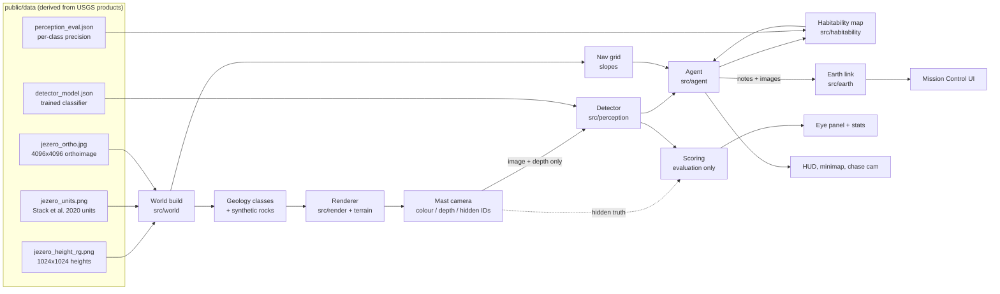

# Architecture

How the pieces fit, the decisions behind them, and what happens when things go wrong. Everything here describes the code as it is; file paths are real.

The app is a **static site** (Vite + TypeScript + Three.js). There is no backend. The world, the agent, the detector and the Earth link all run in the browser.

## Data flow



The dashed line is the one rule that matters: ground truth reaches only the scoring code and the UI, never the agent or planner.

## One cycle of the agent

```mermaid
sequenceDiagram
  participant Sim as Simulation step (10 s sub-steps)
  participant Agent
  participant Cam as Mast camera (GPU)
  participant Det as Detector
  participant Hab as Habitability map
  participant Plan as Planner
  participant Link as Earth link
  Sim->>Agent: step(dt)
  Agent->>Agent: sense: hazcam notes boulders within 14 m
  Agent->>Cam: request image (look-ahead, or 3-pan sweep at a goal)
  Cam-->>Agent: AgentFrame (image + depth)
  Agent->>Det: detect(frame)
  Det-->>Agent: detections (class, confidence, box, range)
  Agent->>Hab: assess: add evidence
  Hab-->>Agent: verdict level, heat
  Agent->>Plan: decide(observation)
  Plan-->>Agent: drive / hibernate / wait
  Agent->>Agent: act: follow A* path, replan on new obstacle
  Agent->>Link: report: queue image (science value) and notes
  Link-->>Link: relay pass sends highest priority first
  Link-->>Link: arrives one light-time later at Mission Control
```

Camera requests are fulfilled by the render loop (`src/main.ts`), one per animation frame, because only it owns the GPU. The agent itself has no GPU access.

## Folder map

| Path | What lives there |
| --- | --- |
| `src/main.ts` | Wires everything: renderer, UI, the camera request loop, scoring |
| `src/world/` | Class table (`classes.ts`), geology builder (`geology.ts`), synthetic rocks, world loader |
| `src/terrain/` | Height map decoding, terrain mesh and shader (normal map, detail, mirrored filler tiles) |
| `src/render/` | Sky dome, sun and shadows, rover and rock models, ACES tone mapping |
| `src/sim/` | Clock, Mars sun and atmosphere, energy model, rover kinematics, the `Simulation` object |
| `src/nav/` | Navigation grid and A* with slope limits |
| `src/agent/` | The agent loop, known map, `Planner` interface and the utility planner |
| `src/perception/` | Camera, ID pass, features, detector, scoring, dev `lab` harness |
| `src/habitability/` | Evidence rules, scoring, environment readouts |
| `src/earth/` | Light time, link and queue, priority, image encoding |
| `src/ui/` | HUD, minimap, eye panel, perception, habitability and Earth panels |
| `tests/` | Unit tests (Vitest); `tests/helpers.ts` builds synthetic terrain |
| `e2e/` | Playwright smoke test |
| `scripts/` | Data preparation (Python), detector training, benchmark |
| `public/data/` | The derived data the app loads at runtime |
| `docs/` | These documents, plus `issues/` drafts |

## Decisions and trade-offs

**Real data first, honest labels.** The terrain is a window of the 1 m HiRISE DTM and the texture is the real 25 cm orthoimage. The first version used a 20 m CTX DEM; at 5 km it looked smooth and gave no real detail, so I switched to a 2 km window of the 1 m data. The cost is a 4.4 MB data folder and a licence I could not verify automatically (see `DATA_SOURCES.md`). Where the data cannot say something (rocks, minerals), the code and docs say "assumed" or "synthetic" instead of implying otherwise.

**A hidden second render for ground truth.** Instead of asking the world "what is at this pixel" during scoring, the scene is rendered again with flat unique colours. That makes truth exact, cheap and impossible for the agent to reach by accident. Terrain patches use a nearest-neighbour ID texture so IDs never blend; filler terrain outside the real patch reports "unknown".

**Perception by training, rocks by geometry.** Terrain classes are learned (so accuracy is measured, not guessed); rocks are found from depth because their defining property is that they stick up from the ground. The first rock detector used a mean-based height residual and found almost nothing; the morphological top-hat fixed it (the story is in `PERCEPTION.md`).

**Pluggable planner.** `Planner.decide()` may return a value or a promise, and receives an `Observation` that excludes ground truth. That is the seam for a future LLM planner behind a serverless function; the agent already handles an async decision without blocking the simulation.

**The simulation runs in fixed sub-steps** (at most 10 simulated seconds each) so it stays stable at 14,400x speed, and a frame never advances more than 0.1 s of wall time, so a throttled tab does not teleport the rover.

**Evidence accumulates, the verdict is derived.** The habitability map stores per-cell, per-class sightings and computes scores on demand, so changing the dust level or time of day updates UV and cold readouts without re-running perception.

**Deviations from the obvious approach.** (1) A trained classifier instead of hand thresholds. (2) CPU tone mapping of the camera so the agent's image matches the screen. (3) Negative habitability factors multiply the score instead of subtracting, because subtraction erased weak evidence entirely (found in testing). (4) TypeScript is pinned to 6.0 because `typescript-eslint` does not support 6.1 or 7 yet.

## Failure modes

| What goes wrong | What happens | Where it is handled |
| --- | --- | --- |
| WebGL 2 unavailable | The renderer cannot start; the error is printed on the page | `main()` catch in `src/main.ts` |
| Height map or unit map fails to load | Same error message; the world cannot be built | `loadWorld` in `src/world/world.ts` |
| Orthoimage missing | App still runs; terrain falls back to a class-colour texture with small per-texel variation | `loadOrtho` in `src/world/world.ts` |
| `detector_model.json` missing | Only rocks are detected; the Perception panel says no trained model was found | `loadDetectorModel`, `src/ui/perceptionPanel.ts` |
| `perception_eval.json` missing | Detector reliability defaults to 0.5 for every class | `loadReliability` |
| No A* path to a goal | The planner skips that candidate; if a drive in progress becomes impossible the agent abandons it and sends a note | `UtilityPlanner`, `Agent.checkPathStillClear` |
| New boulder blocks the path | Replan to the same goal | `Agent.checkPathStillClear` |
| Battery under the minimum | The agent waits and charges and sends a safety note; it plans drives to leave a night-survival reserve | `UtilityPlanner`, `Agent.apply` |
| Sun below the working elevation | The rover hibernates until sunrise; periodic look-around images are suppressed below 8 degrees (the sweep at a goal is not) | `Agent.step`, `Agent.sense` |
| Rover starts or drives on loose sand | Not prevented: navigation uses only the orbital slope limit and sensed boulders, so loose-sand hazards are detected but not avoided (a known gap) | n/a |
| Detector is overconfident far away | Confidence is capped at 0.97 and multiplied by range, sun, haze and occlusion factors | `visibility` in `detector.ts` |
| Image cannot be JPEG-encoded | A console warning; that image is not queued | `submitFrame` caller in `src/main.ts` |
| Downlink queue is full | The lowest-priority item is dropped and logged | `EarthLink.enqueue` |
| Detector blocks the main thread | A frame hitch of about 85 ms whenever the rover takes an image | `docs/PERFORMANCE.md` |
| Tab in the background | The wall-clock step is capped at 0.1 s, so the simulation slows instead of jumping | `Simulation.advance` |
